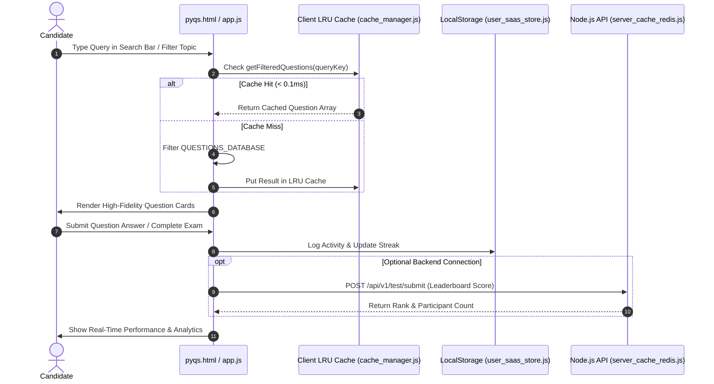

# GATEGuide Architecture & Design Specification (`ARCHITECTURE.md`)

---

## 1. System Architecture Overview

GATEGuide utilizes a **Hybrid Multi-Tier Architecture** centered around a 100% offline-first, client-side Single-Page Application (SPA) paired with an optional Node.js backend cache API service.

```
+-----------------------------------------------------------------------------------------+
|                              GATEGuide Multi-Tier Architecture                          |
+--------------------------+------------------------------------+-------------------------+
| Layer Tier               | Implementation Technology          | Production Status       |
+--------------------------+------------------------------------+-------------------------+
| Tier 1: Client LRU Cache | In-Memory LRU (cache_manager.js)   | ✅ Implemented & Active  |
| Tier 2: Device Storage   | LocalStorage (user_saas_store.js)  | ✅ Implemented & Active  |
| Tier 3: Client PDF Engine| Client jsPDF + AutoTable           | ✅ Implemented & Active  |
| Tier 4: Backend API      | Node.js Server (server_cache_redis)| ⚡ Implemented Prototype |
| Tier 5: Redis Distributed| ioredis (TCP socket fallback)      | ⚡ Optional Extension   |
| Tier 6: Cloud Edge / CDN | Cloudflare / Nginx Reverse Proxy   | 🎯 Proposed Target      |
| Tier 7: Persistent DB    | PostgreSQL / MongoDB Cluster       | 🎯 Proposed Target      |
+--------------------------+------------------------------------+-------------------------+
```

> [!NOTE]
> **Architecture Clarification**: The core offline educational platform operates 100% locally in the candidate's browser (Tiers 1, 2, 3) without requiring any backend server. Tiers 4 and 5 provide an optional Node.js backend prototype with a true sliding-window rate limiter, while Tiers 6 and 7 represent future SaaS production deployment targets.

---

## 2. Design System Tokens (`countries.dev` Standard)

All interfaces share CSS custom properties defined in `styles.css`:

```css
:root {
    --bg-main: #0a0a0c;
    --bg-sidebar: #0e121b;
    --card-bg: rgba(18, 24, 38, 0.7);
    --card-border: rgba(255, 255, 255, 0.08);
    --card-border-hover: rgba(56, 189, 248, 0.35);
    
    --text-primary: #ffffff;
    --text-secondary: #94a3b8;
    --text-muted: #64748b;
    
    --accent-blue: #2563eb;
    --accent-blue-light: #38bdf8;
    --accent-indigo: #6366f1;
    --accent-gold: #d9a441;
    --accent-teal: #4a9a8f;
    
    --font-sans: 'Plus Jakarta Sans', system-ui, -apple-system, sans-serif;
    --font-mono: 'Fira Code', 'Geist Mono', monospace;
    
    --radius-full: 9999px;
    --radius-lg: 16px;
    --radius-md: 10px;
}
```

---

## 3. Data Flow & State Management



---

## 4. Offline-First Compliance & Security Controls

- **Zero External Telemetry Requirement**: Core question retrieval, practice submission, exam simulation, PDF export, and study logs run 100% locally in the browser without network connection.
- **Client Security**: No private API keys or tokens are stored in client-side bundles.
- **CORS Protection**: Base64 asset inlining prevents cross-origin image loading errors under `file:///` protocol.
- **Rate Limiting Security**: Node.js backend prototype employs a true sliding-window log bucket rate limiter (150 req/min limit per IP) to prevent server flooding.
