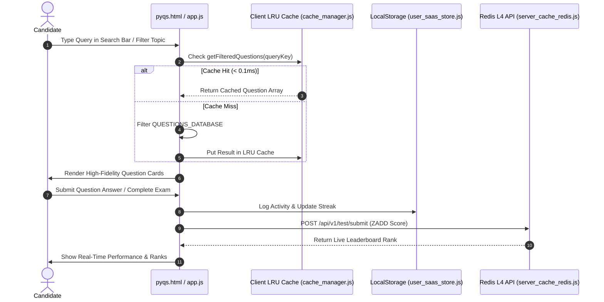

# GATEGuide Architecture & Design Specification (`ARCHITECTURE.md`)

---

## 1. System Architecture Overview

GATEGuide follows a **Multi-Tier Hybrid Architecture** combining a zero-dependency client-side single-page application (SPA) with an optional high-performance Redis L4 server layer.

```
+-----------------------------------------------------------------------------------+
|                            GATEGuide Multi-Tier Architecture                       |
+--------------------------+--------------------------------------------------------+
| Tier 1: Client Memory    | LRU Cache Engine (120 query capacity, < 0.1ms latency) |
| Tier 2: Client Storage   | LocalStorage & IndexedDB (Session, Streak, Activity)   |
| Tier 3: Edge & CDN       | Cloudflare/Nginx HTTP Caching (Assets, Fonts, PDFs)    |
| Tier 4: Server Cache API | Node.js + Redis Cluster (35,000+ QPS, ZADD Ranks)      |
| Tier 5: Persistent DB    | PostgreSQL / MongoDB (User Profiles & Analytics)       |
+--------------------------+--------------------------------------------------------+
```

---

## 2. Design System Tokens (`countries.dev` Standard)

All interfaces share CSS custom properties defined in `styles.css`:

```css
:root {
    --bg-main: #0a0a0c;
    --bg-sidebar: #0e121b;
    --card-bg: rgba(18, 24, 38, 0.7);
    --card-border: rgba(255, 255, 255, 0.08);
    --card-border-hover: rgba(56, 189, 248, 0.35);
    
    --text-primary: #ffffff;
    --text-secondary: #94a3b8;
    --text-muted: #64748b;
    
    --accent-blue: #2563eb;
    --accent-blue-light: #38bdf8;
    --accent-indigo: #6366f1;
    --accent-gold: #d9a441;
    --accent-teal: #4a9a8f;
    
    --font-sans: 'Plus Jakarta Sans', system-ui, -apple-system, sans-serif;
    --font-mono: 'Fira Code', 'Geist Mono', monospace;
    
    --radius-full: 9999px;
    --radius-lg: 16px;
    --radius-md: 10px;
}
```

---

## 3. Data Flow & State Management



---

## 4. Offline-First Compliance & Security

- **Zero External Telemetry Requirement**: Core question retrieval, practice submission, exam simulation, PDF export, and study logs run 100% locally in the browser without network connection.
- **Client Security**: No private API keys or tokens are stored in client-side bundles.
- **CORS Protection**: Base64 asset inlining prevents cross-origin image loading errors under `file:///` protocol.
