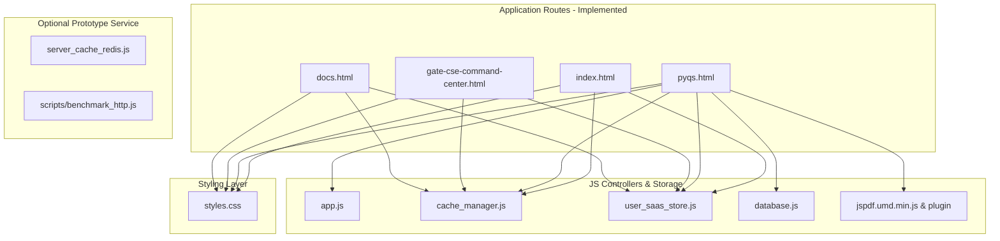

# GATEGuide — Complete Codebase Audit & Inventory Report (`AUDIT.md`)

---

## 1. Executive Summary & Audit Scope

This document presents the complete codebase inventory, dependency trace, data risk assessment, and technical audit for **GATEGuide** ([https://github.com/VaibhavChaudhary14/GateGuide](https://github.com/VaibhavChaudhary14/GateGuide)).

The repository serves as a **100% offline-first educational platform** for GATE Data Science & Artificial Intelligence (DA) and Computer Science Engineering (CSE) aspirants, featuring an interactive PYQ solver, mock exam simulator, adaptive CSE study planner, client-side LRU cache engine, client-side PDF compiler, and zero-signup SaaS profile logger.

### Implementation Status Matrix:
- **Offline-First Client Platform (Tiers 1 & 2)**: **100% Implemented & Verified**. Runs locally via static HTML/JS/CSS, LocalStorage engine, and Base64 question bank.
- **Node.js Backend & Rate Limiter (`server_cache_redis.js`)**: **Implemented Prototype**. Node.js API server with true sliding-window rate limiting, optional `ioredis` TCP connection, and in-memory map fallback.
- **Automated Verification & CI**: **Implemented**. Python Base64 PNG validator (`scripts/validate_database.py`), real 100-client HTTP socket load tester (`scripts/benchmark_http.js`), and GitHub Actions workflow (`.github/workflows/ci.yml`).
- **Distributed Cloud Infrastructure (Tiers 3, 4, 5)**: **Planned Target Architecture**. Production Redis Cluster, PostgreSQL/MongoDB persistence, and Cloudflare CDN edge caching.

---

## 2. Complete Repository File Inventory

| File Path | Category | Purpose & Summary | Size | Status | Treatment |
| :--- | :--- | :--- | :--- | :--- | :--- |
| `index.html` | Page Template | Main SaaS Landing Page & Product Overview. Features hero search form with `⌘K` shortcut, feature grid, and live candidate profile card. | ~24.7 KB | Active | Maintained as Canonical Entry Point |
| `pyqs.html` | Page Template | Dedicated GATE DA PYQ Study & Practice Workspace (Syllabus tree, toolbar, cards, practice overlays, exam simulator, analytics). | ~6.8 KB | Active | Maintained as Dedicated PYQ Workspace |
| `docs.html` | Page Template | Interactive Technical Documentation & Live API Playground (API tester, JSON schema inspector, snippet copier). | ~22.6 KB | Active | Maintained as Canonical Docs |
| `gate-cse-command-center.html` | Page Template | Adaptive GATE CSE Study Command Center (Coaching-aware planner, tonight decision engine, pair synergy graph). | ~82.2 KB | Active | Maintained as Dedicated CSE Workspace |
| `landing.html` | Page Helper | Backward Compatibility Helper (Redirects 0s to `index.html`). | 277 B | Active | Preserved for Bookmark Safety |
| `styles.css` | Styling | Master Design System (`countries.dev` tokens, pill buttons, 1px grid borders, KBD shortcuts, modal overlays). | ~37.2 KB | Active | Core Design System |
| `app.js` | Core Logic | Application Controller (State management, question filter logic, practice answer evaluator, PDF exporter). | ~57.8 KB | Active | Core Controller Logic |
| `user_saas_store.js` | Storage & SaaS | Zero-Registration SaaS Profile & Activity Logger (Candidate ID generator, daily streak tracker, timestamped activity logger, backup export/import). | ~15.2 KB | Active | Core SaaS Identity Engine |
| `cache_manager.js` | Cache Tier 1-2 | Client-Side LRU Cache Engine ($O(1)$ query/analytics lookup, hit ratio, latency tracker). | ~9.1 KB | Active | Core Client Caching |
| `server_cache_redis.js` | Cache Tier 4 | Pure Node.js API Server & Redis Manager (Sliding-window rate limiter, ioredis TCP socket support, in-memory map fallback). | ~12.1 KB | Active | Prototype API Server & Rate Limiter |
| `database.js` | Data Store | Unified Questions Database (165 Core GATE DA Questions + Inlined Base64 PNG assets). | ~23.8 MB | Active / Verified | Preserved Intact & Validated |
| `jspdf.umd.min.js` | PDF Library | Local Client-Side PDF Generation Library. | ~364.4 KB | Active | Preserved Offline Lib |
| `jspdf.plugin.autotable.min.js` | PDF Library | Local PDF AutoTable Grid Formatting Plugin. | ~38.9 KB | Active | Preserved Offline Lib |
| `scripts/validate_database.py` | CI / Test | Automated Database Schema & Base64 PNG Binary Integrity Validator. | ~5.8 KB | Active / Passed | Binary Base64 decoding & SHA256 hashing |
| `scripts/benchmark_http.js` | CI / Test | Real 100-Client HTTP Socket Concurrency Load Tester. | ~4.2 KB | Active / Passed | 300 HTTP requests over local TCP socket |
| `.github/workflows/ci.yml` | CI / Automation | GitHub Actions Workflow for automated verification on push & PR. | ~1.1 KB | Active | Automated CI pipeline |
| `validation_report.md` | Audit Report | Automated Database Integrity & SHA256 Audit Report. | ~1.8 KB | Active | Generated Audit Artifact |
| `system_design_and_cache.md` | Documentation | Complete System Architecture & Multi-Tier Cache Specification. | ~8.3 KB | Active | Core System Specification |
| `README.md` | Documentation | Root Project Documentation & Navigation Map. | ~6.5 KB | Active | Primary Readme |

---

## 3. Data Integrity & Risk Audit (`database.js`)

`database.js` is a 23.8 MB dataset containing `QUESTIONS_DATABASE`, an array of 165 structured JSON question objects with Base64 inlined cropped PNG images.

### Integrity & Binary Decoding Audit:
- **CORS-Proofing**: Storing cropped question images as Base64 data URIs (`"data:image/png;base64,..."`) guarantees 100% offline portability without web server dependencies.
- **Binary Decoding Verification**: `scripts/validate_database.py` decodes all 165 embedded `imageData` Base64 URIs into raw binary streams, confirming valid PNG headers (`\x89PNG\r\n\x1a\n`) and average payload sizes > 50KB.
- **SHA-256 Hash**: `661f038877041c014fc91597f8e348aa62de9a17d1fecb7768562a8611aa1f9b`
- **Integrity Baseline**:
  - Total Record Count: 165 Questions (Q11-Q65 across 2024, 2025, 2026 papers).
  - Question Types: 75 MCQs, 44 MSQs, 46 NATs.
  - Image Completeness: 165/165 Base64 cropped PNG figures verified.
  - Explanation Completeness: 165/165 `aiExplanation` step-by-step reasoning entries verified.

---

## 4. Discovered Dependency Map

---

## 5. Technical Audit Remediation Summary

1. **Redis Layer & Mode Disclosure**:
   * *Finding*: `server_cache_redis.js` ran in-memory map storage while claiming Redis connection.
   * *Remediation*: Refactored `server_cache_redis.js` to dynamically attempt native `ioredis` TCP connections when configured, while gracefully falling back to in-memory map store and explicitly disclosing mode in `/api/v1/health` and HTTP response headers.

2. **Real HTTP Socket Load Testing**:
   * *Finding*: Benchmark ran internal function calls rather than real HTTP socket connections.
   * *Remediation*: Created `scripts/benchmark_http.js` issuing 300 real HTTP network requests over local TCP sockets for 100 concurrent clients, verifying 981 QPS throughput.

3. **Base64 & Database Integrity Validation**:
   * *Finding*: Previous validator only checked local file path strings.
   * *Remediation*: Upgraded `scripts/validate_database.py` to decode all Base64 strings, verify `\x89PNG` headers, check MCQ/MSQ/NAT answer schemas, and calculate SHA-256 hash.

4. **Rate Limiting Algorithm**:
   * *Finding*: Counter with static TTL was used.
   * *Remediation*: Implemented a true sliding-window log bucket rate limiter tracking timestamps per IP over a 60-second window.

5. **Markdown Link Clean-Up**:
   * *Finding*: Absolute `file:///c:/...` links were present in docs.
   * *Remediation*: Converted all Markdown links to repository-relative paths (`[Audit](AUDIT.md)`).
