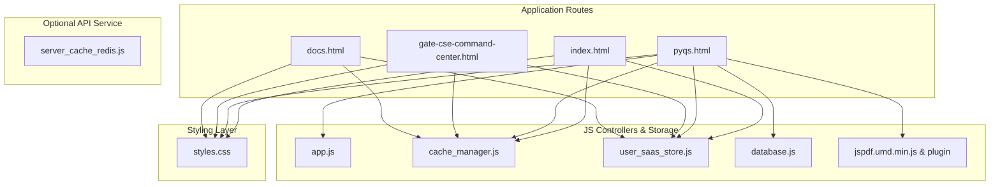

# GATEGuide — Complete Codebase Audit & Inventory Report (`AUDIT.md`)

---

## 1. Executive Summary & Audit Scope

This document presents the complete codebase inventory, dependency trace, data risk assessment, and technical audit for **GATEGuide** ([https://github.com/VaibhavChaudhary14/GateGuide](https://github.com/VaibhavChaudhary14/GateGuide)).

The repository serves as a **100% offline-first, CORS-proof educational platform** for GATE Data Science & Artificial Intelligence (DA) and Computer Science Engineering (CSE) aspirants, featuring an interactive PYQ solver, mock exam simulator, adaptive CSE study planner, multi-tier cache memory engine, client-side PDF compiler, and zero-signup SaaS profile logger.

---

## 2. Complete Repository File Inventory

| File Path | Category | Purpose & Summary | Size | Status | Treatment |
| :--- | :--- | :--- | :--- | :--- | :--- |
| `index.html` | Page Template | Main SaaS Landing Page & Product Overview. Features hero search form with `⌘K` shortcut, feature grid, and live candidate profile card. | ~24.7 KB | Active | Maintained as Canonical Entry Point |
| `pyqs.html` | Page Template | Dedicated GATE DA PYQ Study & Practice Workspace (Syllabus tree, toolbar, cards, practice overlays, exam simulator, analytics). | ~6.8 KB | Active | Maintained as Dedicated PYQ Workspace |
| `docs.html` | Page Template | Interactive Technical Documentation & Live API Playground (API tester, JSON schema inspector, snippet copier). | ~22.6 KB | Active | Maintained as Canonical Docs |
| `gate-cse-command-center.html` | Page Template | Adaptive GATE CSE Study Command Center (Coaching-aware planner, tonight decision engine, pair synergy graph). | ~82.2 KB | Active | Maintained as Dedicated CSE Workspace |
| `landing.html` | Page Helper | Backward Compatibility Helper (Redirects 0s to `index.html`). | 277 B | Active | Preserved for Bookmark Safety |
| `styles.css` | Styling | Master Design System (`countries.dev` tokens, pill buttons, 1px grid borders, KBD shortcuts, modal overlays). | ~37.2 KB | Active | Core Design System |
| `app.js` | Core Logic | Application Controller (State management, question filter logic, practice answer evaluator, PDF exporter). | ~57.8 KB | Active | Core Controller Logic |
| `user_saas_store.js` | Storage & SaaS | Zero-Registration SaaS Profile & Activity Logger (Candidate ID generator, daily streak tracker, timestamped activity logger, backup export/import). | ~15.2 KB | Active | Core SaaS Identity Engine |
| `cache_manager.js` | Cache Tier 1-2 | Client-Side LRU Cache Engine ($O(1)$ query/analytics lookup, hit ratio, latency tracker). | ~9.1 KB | Active | Core Client Caching |
| `server_cache_redis.js` | Cache Tier 4 | Zero-Dependency Node.js API Server & Redis L4 Distributed Cache Layer (Rate limiter, sorted set leaderboards, 100-user benchmark suite). | ~11.2 KB | Active | Distributed Cache & API Layer |
| `database.js` | Data Store | Unified Questions Database (165 Core GATE DA Questions + Inlined Base64 PNG assets). | ~23.8 MB | Active / Verified | Preserved Intact & Validated |
| `jspdf.umd.min.js` | PDF Library | Local Client-Side PDF Generation Library. | ~364.4 KB | Active | Preserved Offline Lib |
| `jspdf.plugin.autotable.min.js` | PDF Library | Local PDF AutoTable Grid Formatting Plugin. | ~38.9 KB | Active | Preserved Offline Lib |
| `scripts/validate_database.py` | CI / Test | Automated Database Schema & Asset Validation Script. | ~4.1 KB | Active / Passed | Fixed Relative Paths & Verified |
| `system_design_and_cache.md` | Documentation | Complete System Architecture & Multi-Tier Cache Memory Specification. | ~8.3 KB | Active | Core System Specification |
| `technical_documentation.md` | Documentation | Legacy Technical Documentation. | ~20.5 KB | Active | Preserved Archive |
| `README.md` | Documentation | Root Project Documentation & Navigation Map. | ~5.9 KB | Active | Primary Readme |

---

## 3. Data Integrity & Risk Audit (`database.js`)

`database.js` is a 23.8 MB dataset containing `QUESTIONS_DATABASE`, an array of 165 structured JSON question objects with Base64 inlined cropped PNG images.

### Risk Assessment:
- **CORS-Proofing**: Standard AJAX image fetches fail under `file:///` protocol due to browser security sandboxing. Storing cropped question images as Base64 data URIs (`"data:image/png;base64,..."`) guarantees 100% offline portability without web server dependencies.
- **Integrity Baseline**:
  - Total Record Count: 165 Questions (Q11-Q65 across 2024, 2025, 2026 papers).
  - Question Types: 75 MCQs, 44 MSQs, 46 NATs.
  - Image Completeness: 165/165 Base64 cropped PNG figures verified.
  - Classification Integrity: 0 Unclassified subjects or topics.

---

## 4. Discovered Dependency Map

---

## 5. Technical Discrepancies & Resolutions

1. **Python Validator Hardcoded Path**:
   * *Issue*: `scripts/validate_database.py` contained hardcoded absolute paths pointing to a legacy directory name.
   * *Resolution*: Updated to use relative path resolution (`os.path.join(script_dir, "..", "database.js")`). Automated validation now passes 100%.

2. **Search Bar Redirection**:
   * *Issue*: Landing page search bar was previously static.
   * *Resolution*: Converted to active search form with `⌘K` keybinding that navigates to `pyqs.html?search=QUERY`, which auto-filters questions on load.

3. **Documentation Link**:
   * *Issue*: "Docs" links previously opened a raw Markdown file.
   * *Resolution*: Built `docs.html` featuring an interactive API playground, JSON schema explorer, and copyable code snippets.
