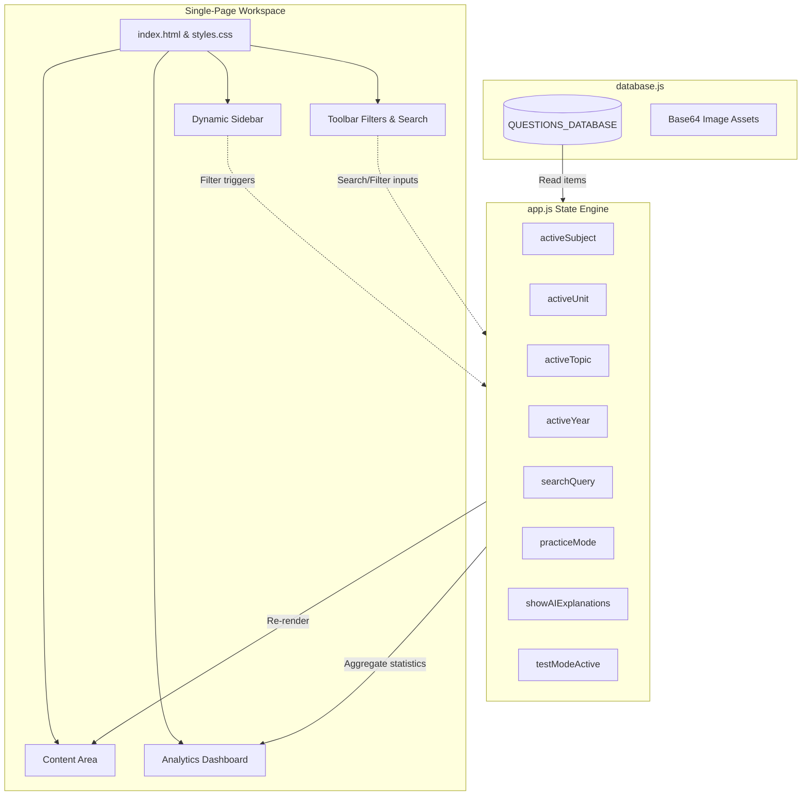

# Technical Documentation: GATE Data Science & AI (DA) PYQ Platform

---

## 1. Executive Summary & Project Overview

The **GATE Data Science & Artificial Intelligence (DA) PYQ Platform** is a premium, client-side academic application designed to archive, analyze, and practice Previous Year Questions (PYQs) from the official GATE DA examinations for the years **2024, 2025, and 2026**. 

### 1.1 Core Objectives
*   **Syllabus-Aligned Organization:** Map every single official question to the corresponding subject, unit, and topic specified in the official GATE DA syllabus.
*   **High-Fidelity Rendering:** Deliver pixel-perfect rendering of mathematical formulas, code blocks, diagrams, and tables through cropped images taken directly from the official question papers, completely avoiding formatting errors or font translation issues common in HTML text representations.
*   **CORS-Proof Local Execution:** Build a 100% offline-first application that operates seamlessly from a local file directory (`file:///` protocol) without requiring a web server or triggering Cross-Origin Resource Sharing (CORS) security exceptions.
*   **Interactive Revision & Testing:** Provide self-evaluation mechanisms through an interactive "Practice Mode" (with instant verification) and a "Practice Test Mode" (mock exam engine with official GATE grading rules).
*   **Offline PDF Generation:** Enable users to export individual questions or compile clean, subject-wise consolidated question banks into high-quality PDFs for offline review.

---

## 2. Technology Stack & Directory Structure

The platform is engineered using a modern, lightweight, non-compiled web framework. By choosing a pure client-side architecture, the system achieves maximum portability, zero deployment overhead, and immediate responsiveness.

### 2.1 Technology Stack
*   **Markup:** HTML5 (semantic layout structure).
*   **Styling:** Vanilla CSS3 (custom CSS variables, CSS grid and flexbox, glassmorphism UI, Google Fonts integration).
*   **Logic:** JavaScript (ES6+ clean event-driven state handling, DOM manipulation, no external compilation needed).
*   **Typography:** *Plus Jakarta Sans* (clean editorial sans-serif) and *Fira Code* (monospace code rendering) imported from Google Fonts.
*   **PDF Engine:** Local copies of [jsPDF](https://github.com/parallax/jsPDF) (`jspdf.umd.min.js`) and [jsPDF-AutoTable](https://github.com/simonbengtsson/jsPDF-AutoTable) (`jspdf.plugin.autotable.min.js`) for generating PDFs client-side.
*   **Data Validation:** Python 3.x (custom schema validation scripts).

### 2.2 Project Structure
```
GATE_DA_2024_2026_PYQ_Platform/
├── index.html                     # Main entry page (unified workspace & UI)
├── styles.css                     # Premium styling sheets
├── app.js                         # Application state and controller logic
├── database.js                    # Core JSON question database + base64 assets
├── gate-da-archive.html           # Historical self-contained archive (2025-2026 only)
├── jspdf.umd.min.js               # Local offline copy of jsPDF v4.x
├── jspdf.plugin.autotable.min.js  # Local offline copy of jsPDF AutoTable plugin
├── scripts/
│   └── validate_database.py       # Automated database schema validation script
└── images/
    └── q_202X_XX.png              # Local fallback crops of the exam questions (165 images)
```

---

## 3. Database System & Data Modeling

The core of the application is powered by a static relational database defined in [database.js](database.js) as a global constant array named `QUESTIONS_DATABASE`.

### 3.1 Question Object Schema
Each question entry in the database is modeled as a structured JSON object with the following fields:

| Field Name | Data Type | Description |
| :--- | :--- | :--- |
| `id` | `String` | Unique identifier formatted as `[Year]_[QuestionNumber]` (e.g., `"2024_11"`). |
| `year` | `Integer` | The academic year of the GATE paper (`2024`, `2025`, or `2026`). |
| `questionNumber`| `Integer` | The actual question number in the official GATE paper (ranges from `11` to `65`). |
| `questionType` | `String` | Type of question: `"MCQ"` (Single-choice), `"MSQ"` (Multi-select), or `"NAT"` (Numerical). |
| `marks` | `Integer` | Weightage of the question: `1` or `2`. |
| `subject` | `String` | Official subject classification under the GATE DA syllabus. |
| `unit` | `String` | Specific unit name within the subject. |
| `topic` | `String` | Sub-topic tag for granular filtering. |
| `questionText` | `String` | Plain text raw translation of the question (used as a fallback and search index). |
| `options` | `Array` | List of option objects, each containing `{ "label": "A/B/C/D", "text": "Content" }`. |
| `figures` | `Array` | Metadata array tracking graphical assets. |
| `tables` | `Array` | Metadata array tracking tabular data structures. |
| `officialAnswer`| `String` | Verified correct key(s) from the official organizing institute's final key. |
| `officialSolution`| `String` | The official solution text (if provided). |
| `aiExplanation` | `String` | Detailed, step-by-step academic explanation written in Markdown format. |
| `sourcePaper` | `String` | Descriptor of source (e.g., `"GATE DA 2024"`). |
| `sourcePage` | `Integer` | Page number in the official PDF document for quick cross-referencing. |
| `imagePath` | `String` | Relative path to local PNG file fallback (e.g., `"images/q_2024_11.png"`). |
| `imageData` | `String` | **CORS Solution:** Complete base64-encoded PNG image data URI of the cropped question text. |

### 3.2 The CORS Resolution: Inlining Base64 Image Assets
Browsers restrict local scripts from loading local files via standard AJAX or standard `<canvas>` drawing when pages are opened from a `file:///` path due to security sandbox policies. To overcome this limitation:
1. Every question crop is converted into a base64-encoded string.
2. This string is stored directly in the `imageData` attribute inside `database.js` (e.g., `"data:image/png;base64,iVBORw..."`).
3. When rendering the page or generating PDFs, the `imageData` is directly assigned to the image elements. This bypasses HTTP requests entirely, ensuring a fully functional **100% offline deployment**.

### 3.3 Database Metrics & Analysis
The database contains exactly **165 questions** extracted from the core sections of the GATE papers (Q11-Q65). General Aptitude (Q1-Q10) is excluded as it is common across all engineering branches.

#### 3.3.1 Question Distribution by Year
*   **GATE 2024:** 55 questions
*   **GATE 2025:** 55 questions
*   **GATE 2026:** 55 questions
*   **Total Database Size:** 165 questions

#### 3.3.2 Question Distribution by Type
*   **Multiple Choice Questions (MCQ):** 75 questions (Features negative marking of $-1/3$ for 1-mark questions and $-2/3$ for 2-mark questions).
*   **Multiple Select Questions (MSQ):** 44 questions (Requires selecting all correct options; no negative marking or partial credit).
*   **Numerical Answer Type (NAT):** 46 questions (Requires entering a real value, evaluated against a single value or range; no negative marking).

#### 3.3.3 Question Distribution by Marks
*   **1-Mark Questions:** 75 questions
*   **2-Marks Questions:** 90 questions
*   **Maximum Paper Marks:** 155 marks (excluding General Aptitude).

#### 3.3.4 Subject-Year Matrix

| Subject Area | 2024 | 2025 | 2026 | Cumulative Total |
| :--- | :---: | :---: | :---: | :---: |
| **Probability & Statistics** | 10 | 12 | 14 | **36** |
| **Programming, Data Structures & Algorithms** | 13 | 9 | 11 | **33** |
| **Machine Learning** | 10 | 9 | 9 | **28** |
| **Database Management & Warehousing** | 4 | 7 | 10 | **21** |
| **Linear Algebra** | 6 | 8 | 4 | **18** |
| **Artificial Intelligence** | 7 | 4 | 6 | **17** |
| **Calculus & Optimization** | 5 | 6 | 1 | **12** |
| **Total** | **55** | **55** | **55** | **165** |

---

## 4. Application Architecture & UI Components

The frontend is structured as a single-page workspace dividing the screen into a navigation sidebar, a toolbar, a main workspace, and an analytics dashboard.



### 4.1 UI Component Breakdown

#### 4.1.1 Navigation Sidebar (Subject-Unit-Topic Tree)
The sidebar renders a dynamic nested accordion reflecting the structure of the official GATE DA syllabus:
1.  **Level 1: Subject Area** (e.g., *Probability & Statistics*, *Machine Learning*). Shows cumulative question badges.
2.  **Level 2: Syllabus Unit** (e.g., *Unit 3 – Continuous Distributions, CDF/PDF & Exponential Distribution*).
3.  **Level 3: Topic** (e.g., *Exponential Distribution*, *Uniform Distribution*).

Clicking on any level filters the active workspace immediately. The DOM tree is constructed dynamically on-load by traversing `QUESTIONS_DATABASE` and grouping entries.

#### 4.1.2 The Toolbar Controls
The toolbar contains search and filtering inputs:
*   **Search Box:** Allows instantaneous regex-free text search. The query filters against `questionText`, `topic`, `subject`, `unit`, and exact question identifiers (e.g., "Q.22" or "2024_22").
*   **Year Selector:** A drop-down menu to restrict results to a specific exam cycle (`2024`, `2025`, `2026`, or `All`).
*   **Practice Mode Toggle:** Switches the content view from a read-only list into an interactive quiz workspace.
*   **AI Explanations Toggle:** Dynamically shows or hides step-by-step academic explanations beneath solutions.

#### 4.1.3 The Main Workspace (Question Cards)
The workspace renders cards matching the selected filters. Each question card is styled with a premium glassmorphic background:
*   **Card Header:** Displays meta-badges indicating year, question number, question type, marks weightage, and topic.
*   **Card Body:** Displays the high-fidelity crop of the question (using the CORS-proof base64 data URI). If the image fails to render, a fallback raw text representation is shown.
*   **Interactive Input Area:** Rendered only when *Practice Mode* is active. Custom input types are used depending on the question:
    *   *MCQ:* Four interactive radio buttons labeled A, B, C, and D.
    *   *MSQ:* Four checkboxes, allowing multi-select logic. Selection is tracked as a semicolon-separated string (e.g., `"A;C;D"`).
    *   *NAT:* A text input box for numerical input.
*   **Interactive Controls:** Buttons to check the submitted response, reset the response, view the question in the original PDF paper, export the specific question card as a standalone PDF, or toggle the official solution drawer.

#### 4.1.4 The Analytics Dashboard
Located at the bottom of the workspace, this section provides analytical summaries:
1.  **High-Priority Topics:** Lists the most frequently examined topics across the three papers, calculated by recurrence counts and sorted in descending order.
2.  **Identical / Repeated Questions:** Spotlights concepts that have appeared with identical logic and layouts across cycles (e.g., *Bayes' Theorem probability calculation* appearing in both 2024 and 2026 as Q58).
3.  **Year-wise Subject Distribution:** Features interactive color-coded stacked horizontal bars representing the proportion of questions allocated to each syllabus subject per year. Clicking a slice directly navigates to that subject.

---

## 5. State Management & Interaction Logic

All state management is handled inside [app.js](app.js) using global state variables. State updates trigger modular DOM rendering methods (`renderSidebar()`, `renderContent()`, `renderDashboard()`).

### 5.1 Global State Properties
```javascript
let activeSubject = "All Subjects"; // Active subject filter
let activeUnit = "All Units";       // Active unit filter
let activeTopic = "All Topics";     // Active topic filter
let activeYear = "all";             // "all", "2024", "2025", "2026"
let searchQuery = "";               // Text query filter
let practiceMode = false;           // Toggles input overlays
let showAIExplanations = false;     // Toggles AI step-by-step visibility
let userAnswers = {};               // Stores answers in study mode (qId -> answerStr)
let submittedAnswers = {};          // Tracks submitted state (qId -> boolean)
```

### 5.2 NAT Evaluation Algorithm (Numerical Tolerance Support)
Evaluating Numerical Answer Type (NAT) questions requires matching numeric strings while respecting official range tolerances. The validation logic is implemented in the `validateAnswer(q, answer)` function:

```javascript
if (q.questionType === "NAT") {
    // Check if the official answer specifies a range (e.g., "0.12 TO 0.13")
    if (official.includes("TO")) {
        const parts = official.split("TO").map(p => parseFloat(p.trim()));
        const userNum = parseFloat(user);
        if (isNaN(userNum)) return false;
        return userNum >= parts[0] && userNum <= parts[1]; // Range validation
    } else {
        const userNum = parseFloat(user);
        const officialNum = parseFloat(official);
        if (isNaN(userNum) || isNaN(officialNum)) {
            return user === official; // Fallback string match
        }
        return Math.abs(userNum - officialNum) < 1e-4; // Standard precision tolerance
    }
}
```

---

## 6. The Practice Mock Test Engine

A core feature of the platform is the **Practice Test Mode**, which transforms the platform into an exam center simulation.

### 6.1 State Lifecycle & Flow
```
[Study Mode] ──(Click Practice Test Mode)──> [Test Setup Panel]
                                                      │ (Configure Years, Types, Subjects, Length)
                                                      ▼
[Test Results Dashboard] <──(Submit Test)── [Active Test Interface] (Timer Active, Solutions Locked)
           │
           └──(Review Row clicked)──> [Study Mode: Auto-scroll & Reveal Solution]
```

### 6.2 Test Configuration
When entering the setup dashboard, users can customize:
*   **Exam Sources:** Checkboxes to select combinations of the 2024, 2025, and 2026 papers.
*   **Question Formats:** Filter by MCQ, MSQ, or NAT.
*   **Subject Focus:** Select specific subjects to create a targeted mock test.
*   **Test Length:** Choose from preset lengths: 5, 10, 15, 20, 30, or a full paper length (55 questions).

Upon clicking **"Start Practice Test"**, the system filters the matching database subset, shuffles the selected questions using a random index generator (`Math.random() - 0.5`), extracts the configured sample length, starts a timer, and displays the first question.

### 6.3 Grading Logic
The test submission scoring algorithm strictly conforms to the official GATE scoring guidelines, including differential marking and negative penalties:

$$\text{MCQ Penalty} = -\frac{\text{Question Marks}}{3}$$

No penalties apply to MSQ and NAT questions. The evaluation algorithm compiles scores using the following logic:

```javascript
testQuestions.forEach(q => {
    const userVal = testAnswers[q.id] || "";
    const isCorrect = validateAnswer(q, userVal);
    
    let earnedMarks = 0;
    if (isCorrect) {
        earnedMarks = q.marks;
        correctCount++;
    } else {
        // Apply negative marking penalty for incorrect MCQ responses only
        if (q.questionType === "MCQ" && userVal !== "") {
            earnedMarks = -q.marks / 3;
        } else {
            earnedMarks = 0; // No penalty for MSQ, NAT or unanswered MCQs
        }
    }
    totalScore += earnedMarks;
});
```

---

## 7. Offline-First PDF Export Engine

The application integrates [jsPDF](https://github.com/parallax/jsPDF) to compile and export premium-grade documents natively in the browser without any server connection.

### 7.1 Standalone Question Card Export
When a user clicks "Download Question PDF", `downloadQuestionPDF(qId)` executes the following pipeline:
1.  Instantiates a new portrait A4 `jsPDF` document.
2.  Creates a virtual `Image` object and sets its `src` to the question's `imageData` Base64 string.
3.  Calculates scaling ratios to ensure the cropped question image fits within A4 page margins without skewing.
4.  Draws exam headers (e.g., "GATE DA 2025", "Marks: 2", "Type: NAT") using standard PDF fonts.
5.  Draws the image onto the PDF document layout using `doc.addImage()`.
6.  Triggers a browser file download titled `GATE-DA-[Year]-Q[Number].pdf`.

### 7.2 Consolidated Subject-Wise Book Compilation
The "Download Subject PDF" option creates a consolidated revision book for a chosen subject:
1.  Draws a dark theme academic cover page (using the primary brand color `#101d2e` and accent gold text `#d9a441`), printing the subject title, year span, and cumulative question count.
2.  Traverses the filtered question set sequentially.
3.  Loads each question crop's Base64 string.
4.  Adds new pages dynamically using `doc.addPage()`.
5.  Renders the question header, followed by the scaled crop.
6.  Draws a running footer showing the current page number and subject watermark.
7.  Saves the consolidated revision book (e.g., `GATE-DA_Machine-Learning_2024-2026.pdf`).

---

## 8. Database Validation Script

To maintain database integrity, [scripts/validate_database.py](scripts/validate_database.py) runs checks against the database before any release.

### 8.1 Validation Checks
1.  **Question Count Verification:** Assures exactly 165 questions are present.
2.  **Question Number Range:** Assures question numbers fall strictly between `11` and `65`.
3.  **Required Attributes:** Validates the presence and data type of `id`, `year`, `questionType`, `subject`, `unit`, `topic`, and `questionText`.
4.  **Options Sufficiency:** Assures MCQ and MSQ questions have at least four valid option objects.
5.  **Image Availability & Path Verification:** Verifies the existence of fallback PNG images in the local `/images` directory.
6.  **Official Keys:** Confirms that the `officialAnswer` attribute is populated and valid (A, B, C, or D for MCQ; semicolon-separated combinations for MSQ; numerical bounds for NAT).
7.  **Classification Integrity:** Warns if any subject, unit, or topic is marked as "Unclassified" or "Needs Review".

### 8.2 Execution & Outputs
Running the validation script yields a CLI summary and compiles a comprehensive Markdown report at the designated platform workspace path:
```bash
python scripts/validate_database.py
```
**Output:**
```
Validation complete! Report written to [Path]\validation_report.md
Validation passed successfully!
```

---

## 9. Architectural Merits & Strengths

*   **Zero Infrastructure Costs:** Because all computing, rendering, scoring, and PDF generation occur in the user's browser, the application requires no database servers, API gateways, or hosting compute costs.
*   **Security & Privacy:** Student progress, answers, test configurations, and elapsed times are stored purely in memory. No user telemetry, exam performance, or input data leaves the local client machine.
*   **Infinite Portability:** The entire application (along with all cropped figures and solutions) can be zipped, emailed, or stored on an offline USB drive. Double-clicking `index.html` launches the full platform experience immediately.
*   **Flawless Mathematical Layouts:** Unlike text-based scrapers that struggle to render LaTeX math symbols or inline diagrams consistently across devices, using cropped PNG images guarantees 100% fidelity to the official papers.
